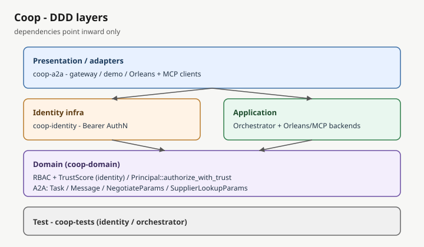

# Coop — Identity + A2A

**A2A phone line** so foreign agents can reach [Lindle](https://github.com/PiotrZak/Lindle) — Orleans Agents and/or Lindle MCP — with AuthN, identity **trust score**, and RBAC.

Not a YCA chat wrapper; YCA construction tools stay on YCA.

## Architecture



```
Foreign A2A agent
        |
        v
 coop-gateway  -- AuthN + TrustScore + AuthZ
        |
        +-- Lindle Orleans  POST /agents/*
        +-- Lindle MCP      tools/call   (optional)
```

**Repo:** https://github.com/PiotrZak/coop

See [docs/ORCHESTRATOR.md](docs/ORCHESTRATOR.md). Langfuse: [docs/TODO_LANGFUSE.md](docs/TODO_LANGFUSE.md) (TODO only).

## Trust score

Identity-based bands (`Low` / `Medium` / `High`) from role + credential strength. Skills require a minimum band (`supplier.read` ≥ Low; `negotiate` / `investigate` ≥ Medium). Source: [`crates/coop-domain/src/trust.rs`](crates/coop-domain/src/trust.rs).

## RBAC

**Source of truth:** [`crates/coop-domain/src/rbac.rs`](crates/coop-domain/src/rbac.rs)

| Skill | Min RBAC | Min trust | Upstream |
|-------|----------|-----------|----------|
| `supplier.read` | Read | Low | MCP `supplier-lookup` (preferred) or Orleans |
| `negotiate` | Act | Medium | Orleans `/agents/negotiate` |
| `investigate` | Act | Medium | Orleans `/agents/investigate` |

Demo keys: `nego-a-demo-key`=`Operator`, `nego-b-demo-key`=`Admin`, `supplier-demo-key`=`Reader`, `gateway-service-key`=`Service`.

## Run locally

```bash
export AGENTS_SERVICE_URL=http://127.0.0.1:8080
export AGENTS_INTERNAL_SECRET=...          # Lindle Agents — never commit
# optional MCP:
# export LINDLE_MCP_URL=http://127.0.0.1:8000/mcp
# export MCP_SERVER_SECRET=...

cargo run -p coop-a2a --bin coop-gateway
cargo run -p coop-a2a --bin coop-demo
```

Agent Card: `GET http://127.0.0.1:7090/.well-known/agent.json`

## Crates (DDD)

| Layer | Crate | Role |
|-------|-------|------|
| Domain | `coop-domain` | RBAC + TrustScore + A2A types |
| Application | `coop-application` | Orchestrator + Orleans/MCP backend config |
| Infrastructure | `coop-identity` | Bearer AuthN |
| Presentation | `coop-a2a` | Gateway + demo client |
| Test | `coop-tests` | Cross-layer tests |

## CI / CD

See [docs/DEPLOY.md](docs/DEPLOY.md).

Apache-2.0.
