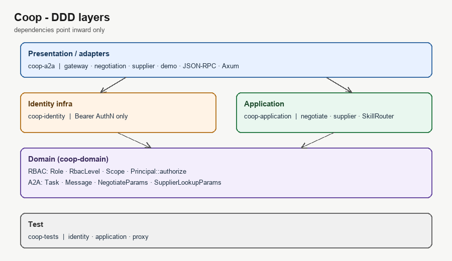

# Coop — Identity + A2A

Open **Identity + A2A** edge for agent-to-agent cooperation (hackathon / Lindle companion).

## Architecture



```
Presentation (coop-a2a bins + HTTP)
        |                |
 Identity AuthN     Application
 (coop-identity)  (coop-application)
        |                |
        +-------> Domain (coop-domain)
                  RBAC + A2A types
                       ^
                 Test (coop-tests)
```

Dependencies point **inward** only: infrastructure → application → domain.

Orleans / Backend.Agents stay authoritative for tenant intelligence in [Lindle](https://github.com/PiotrZak/Lindle). This repo is the **protocol phone line**.

**Repo:** https://github.com/PiotrZak/coop

### Runtime (orchestrator)

Lindle Orleans Agents connect **first** (secure env). See [docs/ORCHESTRATOR.md](docs/ORCHESTRATOR.md).

```
Client --> coop-gateway (orchestrator)
              |-- AuthN (identity) + AuthZ (domain RBAC)
              |-- 1st: Lindle Backend.Agents (AGENTS_SERVICE_URL + AGENTS_INTERNAL_SECRET)
              +-- fallback: local negotiation/supplier bins
```

## RBAC (defined in domain)

**Source of truth:** [`crates/coop-domain/src/rbac.rs`](crates/coop-domain/src/rbac.rs)

Roles are **generic** (not product-named). Each role has a clearance ceiling; any skill/`Scope` whose `required_level` is ≤ that ceiling is allowed. New scopes do not require new roles.

| Role | `max_level` | Typical use |
|------|-------------|-------------|
| `Reader` | `Read` | read-only callers |
| `Contributor` | `Consult` | enrich / advise |
| `Operator` | `Act` | run workflow skills |
| `Admin` | `Admin` | full authority |
| `Service` | `Admin` | gateway / machine identity |

| Skill | Scope | Min level | Lindle upstream |
|-------|-------|-----------|-----------------|
| `negotiate` | `Negotiate` | `Act` | `POST /agents/negotiate` |
| `supplier.read` | `SupplierRead` | `Read` | `POST /agents/optimize-portfolio` |
| `investigate` | `Investigate` | `Act` | `POST /agents/investigate` |

Demo keys → roles: `nego-a-demo-key`=`Operator`, `nego-b-demo-key`=`Admin`, `supplier-demo-key`=`Reader`, `gateway-service-key`=`Service`.

## Authentication (A2A)

| Layer | What |
|-------|------|
| **AuthN** | [`coop-identity`](crates/coop-identity) — Bearer / API-key → `Principal` |
| **AuthZ** | [`Principal::authorize`](crates/coop-domain/src/rbac.rs) — role level ≥ scope requirement |
| **v0 demo** | `Authorization: Bearer <api-key>` |
| **Production** | OAuth2 / OIDC (still Bearer), or mTLS |

## Topology

```text
Client / Negotiation-A  --A2A-->  coop-gateway (:7090)
                                      |
                    +-----------------+-----------------+
                    | skill:negotiate | skill:supplier.read
                    v                 v
              Negotiation-B      Supplier Agent
                  (:7101)            (:7102)
```

## Run locally

Env (only these two for Lindle):

```bash
export AGENTS_SERVICE_URL=http://127.0.0.1:8080
export AGENTS_INTERNAL_SECRET=...   # from Lindle — never commit
cargo run -p coop-a2a --bin coop-gateway
```

Local A2A only — leave those unset:

```bash
cargo run -p coop-a2a --bin coop-supplier
cargo run -p coop-a2a --bin coop-negotiation
cargo run -p coop-a2a --bin coop-gateway
cargo run -p coop-a2a --bin coop-demo -- --peer-url http://127.0.0.1:7090 --supplier-id acme-cloud
```

Agent Cards: `GET http://127.0.0.1:7090/.well-known/agent.json`

## Crates (DDD)

| Layer | Crate | Role |
|-------|-------|------|
| Domain | `coop-domain` | Generic RBAC + A2A aggregates (no I/O) |
| Application | `coop-application` | Use cases: negotiate pack, supplier brief, skill routing |
| Infrastructure | `coop-identity` | Bearer AuthN only |
| Infrastructure / presentation | `coop-a2a` | HTTP/JSON-RPC, Agent Card, bins |
| Test | `coop-tests` | Cross-layer tests |

## CI / CD & Terraform

See [docs/DEPLOY.md](docs/DEPLOY.md).

Apache-2.0.
